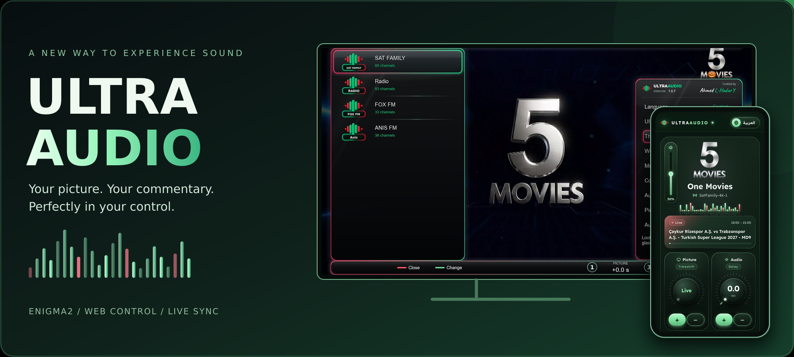
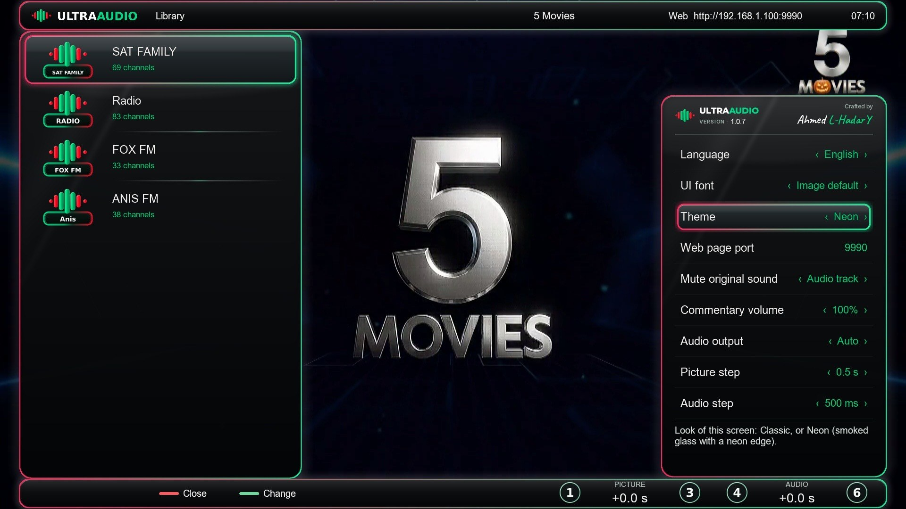
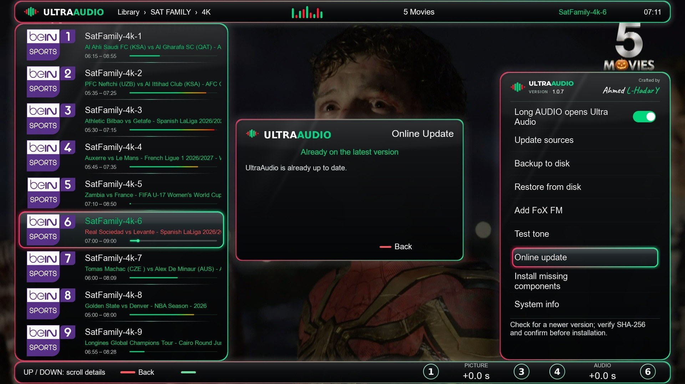
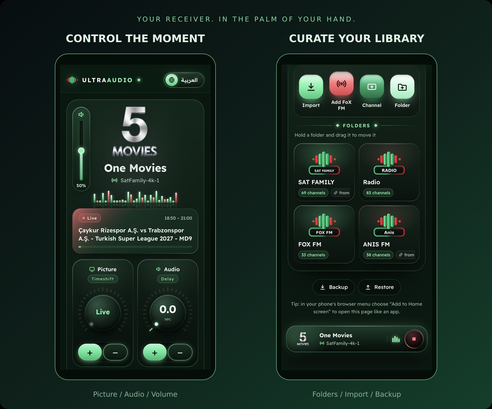
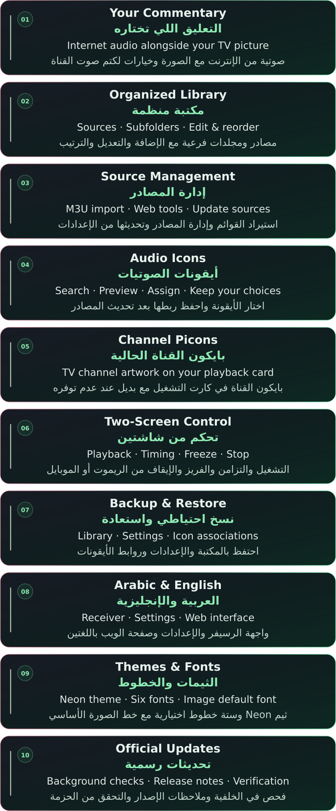
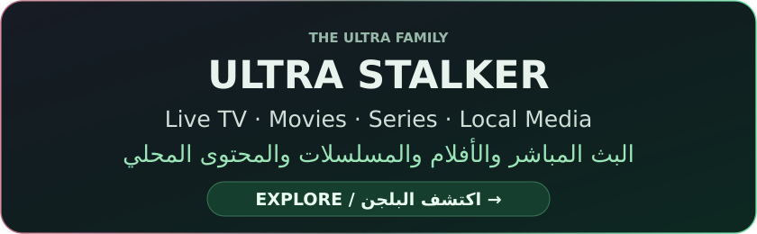
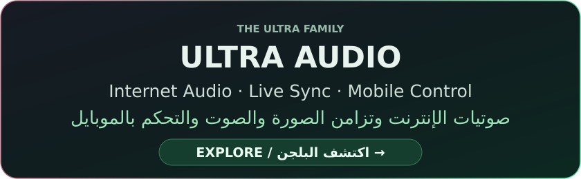

<div align="center">

[](screenshots/ua-hero-neon.png)

### Your picture. Your commentary. Your timing.
### صورتك… تعليقك… والتوقيت على مزاجك.

Internet audio, independent picture/audio timing and control from your receiver or phone — built for Enigma2.

صوتيات الإنترنت، وضبط توقيت الصورة والصوتية بشكل مستقل، والتحكم من الرسيفر أو الموبايل — على أجهزة Enigma2.

[](https://github.com/K3bOra/UltraAudio/releases/latest)
[](#compatibility)
[](#compatibility)
[](https://github.com/K3bOra/UltraAudio/releases)

Platform: Enigma2 · Python: 3.5+ · Official release and download count above.

المنصة: Enigma2 · بايثون: 3.5 أو أحدث · الشارات بالأعلى تعرض الإصدار الرسمي وعدد التنزيلات.

[](#install)
[](https://github.com/K3bOra/UltraAudio/releases)

**[التثبيت الرسمي](#install) · [تحميل الإصدارات الرسمية](https://github.com/K3bOra/UltraAudio/releases)**

[What's new](#updates) · [Screenshots](#experience) · [Mobile control](#mobile) · [Timing](#sync) · [Features](#features) · [Install](#install) · [FAQ](#faq)

[الجديد](#updates) · [الصور](#experience) · [التحكم بالموبايل](#mobile) · [التزامن](#sync) · [المميزات](#features) · [التثبيت](#install) · [الأسئلة الشائعة](#faq)

</div>

---

<a name="overview"></a>

## Meet Ultra Audio
### تعرّف على الترا أوديو

Play internet audio alongside the TV channel you are watching on your Enigma2 receiver. Choose your commentary, adjust picture and audio delays independently, and control playback from the remote or a phone on the same network.

شغّل صوتية من الإنترنت مع قناة التلفزيون اللي بتشاهدها على رسيفر Enigma2. اختار تعليقك، واضبط تأخير الصورة والصوتية كل واحدة لوحدها، وتحكم من الريموت أو الموبايل على نفس الشبكة.

A shared visual language with Ultra Stalker, with its own Neon theme, organized library and dedicated audio controls.

نفس روح التصميم مع الترا ستالكر، مع ثيم Neon الخاص بأوديو ومكتبة منظمة وأدوات مخصصة للتحكم في الصوت.

---

<a name="updates"></a>

## What's new — V1.0.9
### الجديد في V1.0.9

The latest published release is **V1.0.9**. The plugin's product name remains **Ultra Audio Final V1**.

أحدث إصدار منشور هو **V1.0.9**، والاسم الرئيسي للبلجن يظل **Ultra Audio Final V1**.

- Improve picture timeshift adjustment and return to live on Dreambox / OpenATV.<br>تحسين ضبط تايم شيفت الصورة والرجوع للبث المباشر على Dreambox وOpenATV.
- Improve audio delay and saved channel synchronization.<br>تحسين تأخير الصوت واستعادة المزامنة المحفوظة للقنوات.
- Restore missing bundled radio stations, including ON Sport FM, without duplicating imported links.<br>استكمال محطات الراديو الناقصة، ومنها ON Sport FM، مع منع تكرار الروابط المستوردة.
- Unify playing-row colors on the receiver and web: green title and red details.<br>توحيد ألوان العنصر الجاري تشغيله على الرسيفر والويب: الاسم بالأخضر والتفاصيل بالأحمر.

[Full release notes and downloads](https://github.com/K3bOra/UltraAudio/releases/latest) · [Previous releases](https://github.com/K3bOra/UltraAudio/releases)

[تفاصيل الإصدار والتحميل](https://github.com/K3bOra/UltraAudio/releases/latest) · [الإصدارات السابقة](https://github.com/K3bOra/UltraAudio/releases)

---

<a name="experience"></a>

## The experience
### جولة داخل البلجن

### Familiar picture. Your choice of sound.
#### نفس الصورة… بصوت تختاره أنت.

Choose from your audio and radio library while keeping the TV channel on screen. Browse folders, select a source and adjust playback from the plugin.

اختار من مكتبة الصوتيات والراديو مع استمرار عرض قناة التلفزيون. تصفح المجلدات، واختار المصدر واضبط التشغيل من داخل البلجن.

[](screenshots/ua-tv-library-neon.jpg)

<details>
<summary><b>Settings & online updates<br>الإعدادات والتحديث أونلاين</b></summary>

[](screenshots/ua-tv-updates-neon.jpg)

</details>

---

<a name="mobile"></a>

## One experience. Two screens.
### تجربة واحدة… على شاشتين.

The playback card shows the current TV channel, its picon and the selected audio source. Adjust volume and timing, organize folders, import sources and back up your library from your browser.

كارت التشغيل بيعرض قناة التلفزيون الحالية وبايكونها والصوتية المختارة. اضبط مستوى الصوت والتزامن، ونظم المجلدات واستورد المصادر واعمل نسخة احتياطية للمكتبة من المتصفح.

[](screenshots/ua-mobile-showcase.jpg)

[Full control screen](screenshots/ua-mobile-control.jpg) · [Full library screen](screenshots/ua-mobile-library.jpg)

[شاشة التحكم كاملة](screenshots/ua-mobile-control.jpg) · [شاشة المكتبة كاملة](screenshots/ua-mobile-library.jpg)

On a device connected to the **same network as your receiver**, open this address and replace `RECEIVER-IP` with the receiver's local IP:

من جهاز متصل **بنفس شبكة الرسيفر**، افتح العنوان ده واستبدل `RECEIVER-IP` بعنوان الرسيفر المحلي:

```text
http://RECEIVER-IP:9990
```

The default port is **9990** and can be changed in Settings. Add the page to your phone's home screen for quicker access.

المنفذ الافتراضي **9990** ويمكن تغييره من الإعدادات. تقدر تضيف الصفحة للشاشة الرئيسية للموبايل للوصول السريع.

---

<a name="sync"></a>

## Find your perfect timing
### كل تفصيلة في توقيتها

Adjust the picture and internet audio separately until they match the timing you want.

اضبط الصورة والصوتية كل واحدة بشكل مستقل لحد ما توصل للتوقيت المناسب ليك.

| Control<br>التحكم | What it does<br>وظيفته |
|:---|:---|
| **Picture / Timeshift**<br>الصورة / التايم شيفت | Adjust the delay of the TV picture.<br>ضبط تأخير صورة التلفزيون. |
| **Audio / Delay**<br>الصوتية / التأخير | Increase or reduce audio delay, or reset it to zero.<br>زيادة أو تقليل تأخير الصوتية، أو إرجاعه للصفر. |
| **Freeze / Resume**<br>التجميد / الاستئناف | Freeze or resume the picture from the remote or web interface.<br>تجميد الصورة أو استئنافها من الريموت أو صفحة الويب. |
| **Per-channel memory**<br>ذاكرة لكل قناة | Remember the audio source and timing for each TV channel.<br>حفظ الصوتية والتزامن لكل قناة تلفزيون واستعادتهما عند الرجوع إليها. |
| **Stop**<br>إيقاف | Stop the audio and clear the channel's saved association.<br>إيقاف الصوتية وإلغاء الربط المحفوظ للقناة. |

Picture delay requires working timeshift and suitable storage on the receiver.

تأخير الصورة يحتاج تايم شيفت شغال ومساحة تخزين مناسبة على الرسيفر.

### Remote shortcuts
#### اختصارات الريموت

| Key<br>الزر | Action<br>الوظيفة |
|:---|:---|
| **1 / 3** | Adjust picture delay.<br>تعديل تأخير الصورة. |
| **4 / 6** | Adjust audio delay.<br>تعديل تأخير الصوتية. |
| **Green**<br>الأخضر | Freeze / resume the picture.<br>تجميد الصورة أو استئنافها. |
| **Red**<br>الأحمر | Stop the audio.<br>إيقاف الصوتية. |
| **Blue**<br>الأزرق | Reset audio delay to zero.<br>إعادة تأخير الصوتية للصفر. |
| **Yellow / 0**<br>الأصفر / 0 | Return the picture to live and close timeshift.<br>إرجاع الصورة لايف وإغلاق التايم شيفت. |
| **CH+ / CH−** | Move between Settings pages.<br>التنقل بين صفحات الإعدادات. |

---

<a name="features"></a>

## More control. Less effort.
### تحكم أكتر… بخطوات أبسط.

[](screenshots/premium-features-audio.svg)

<details>
<summary><b>Full feature descriptions<br>تفاصيل المميزات كاملة</b></summary>

**Your commentary**

**صوتية مع قناة الرسيفر**

Internet audio alongside the current TV picture, with options to mute the channel's original audio.

تشغيل صوتية إنترنت مع الصورة الحالية، مع خيارات لكتم صوت القناة الأصلي.

**Organized library**

**مكتبة منظمة**

Sources and subfolders with add, edit, delete and ordering controls.

مصادر ومجلدات فرعية، مع الإضافة والتعديل والحذف وترتيب القوائم.

**Source management**

**إدارة المصادر**

Import M3U lists and manage sources from the plugin or web interface; update sources from Settings.

استيراد قوائم M3U وإدارة المصادر من البلجن أو الويب، وتحديث المصادر من الإعدادات.

**Audio icons**

**أيقونات الصوتيات**

Search, preview and assign included icons from the web interface; associations survive source updates and backups.

البحث في الأيقونات المرفقة ومعاينتها واختيارها من الويب، مع حفظ الربط بعد تحديث المصادر والنسخ الاحتياطي.

**Channel picons**

**بايكون القناة**

Show the current TV channel picon, with a fallback when unavailable.

عرض بايكون قناة التلفزيون الحالية، مع أيقونة بديلة عند عدم توفره.

**Two-screen control**

**تحكم من شاشتين**

Playback, timing, freeze and stop from the remote or phone.

التشغيل والتأخير والفريز والإيقاف من الريموت أو الموبايل.

**Backup & restore**

**نسخ احتياطي واستعادة**

Preserve the library, settings and icon associations.

حفظ المكتبة والإعدادات وروابط الأيقونات.

**Arabic & English**

**العربية والإنجليزية**

Both languages across the receiver interface, Settings and web page.

واجهة الرسيفر والإعدادات وصفحة الويب باللغتين.

**Themes & fonts**

**الثيمات والخطوط**

Neon theme, six optional Arabic/English fonts and the image's default font.

ثيم Neon، وستة خطوط عربية وإنجليزية اختيارية، بالإضافة لخط الصورة الأساسي.

**Official online updates**

**تحديث رسمي أونلاين**

Background checks, release notes and package verification before installation.

فحص في الخلفية وعرض ملاحظات الإصدار والتحقق من الحزمة قبل التثبيت.

</details>

---

<a name="compatibility"></a>

## Compatibility
### التوافق والمتطلبات

| Requirement<br>المتطلب | Details<br>التفاصيل |
|:---|:---|
| Platform<br>المنصة | Enigma2 receiver<br>رسيفر Enigma2 |
| Python<br>بايثون | Python 3.5 or newer<br>بايثون 3.5 أو أحدث |
| Access<br>الوصول | Root via Telnet / SSH<br>حساب root عبر Telnet أو SSH |
| Internet<br>الإنترنت | Required for online sources and updates.<br>مطلوب لمصادر الإنترنت والتحديثات. |
| Picture delay<br>تأخير الصورة | Working timeshift and suitable receiver storage.<br>تايم شيفت شغال وتخزين مناسب على الرسيفر. |
| Mobile control<br>التحكم من الموبايل | A browser on the same local network.<br>متصفح متصل بنفس الشبكة المحلية. |

These are the published requirements, not confirmation that every receiver and image has been tested.

دي المتطلبات المنشورة، وليست تأكيدًا إن كل جهاز وصورة تشغيل تم اختبارهم عمليًا.

---

<a name="install"></a>

## Official installation
### التثبيت الرسمي

Open Telnet or SSH on a compatible receiver as **root**, then run:

افتح Telnet أو SSH على رسيفر متوافق بحساب **root**، ثم نفّذ:

```sh
wget -qO- https://raw.githubusercontent.com/K3bOra/UltraAudio/main/install.sh | /bin/sh
```

The installer downloads the official release and verifies the SHA-256, package size, name and version. Setup checks required components and attempts to install missing components from the receiver image's feeds.

المُثبّت بيحمّل الإصدار الرسمي ويتحقق من بصمة SHA-256 وحجم الحزمة واسمها ورقمها. وبعدها التجهيز بيفحص المكونات المطلوبة وبيحاول يثبت الناقص من مستودعات صورة الرسيفر.

[Review the installer](install.sh) · [Download the latest IPK](https://github.com/K3bOra/UltraAudio/releases/latest)

[راجع سكربت التثبيت](install.sh) · [حمّل أحدث حزمة IPK](https://github.com/K3bOra/UltraAudio/releases/latest)

> Setup restarts Enigma2 after successful checks. Back up important receiver settings first.
>
> التجهيز بيعيد تشغيل واجهة Enigma2 بعد نجاح الفحص. احتفظ بنسخة احتياطية من إعدادات الرسيفر المهمة أولًا.

### First run
#### أول تشغيل

1. Tune to the TV channel you want to watch.<br>شغّل قناة التلفزيون اللي عايز تشاهدها.
2. Open Ultra Audio and select your audio source.<br>افتح الترا أوديو واختار الصوتية المناسبة.
3. Adjust picture and audio timing from the remote or web page.<br>اضبط توقيت الصورة والصوتية من الريموت أو صفحة الويب.
4. Return to the channel and enjoy your chosen commentary.<br>ارجع للقناة واستمتع بالتعليق اللي اخترته.

---

<a name="faq"></a>

## Troubleshooting & FAQ
### حل المشاكل والأسئلة الشائعة

<details>
<summary><b>The mobile page will not open.<br>صفحة الموبايل مش بتفتح.</b></summary>

Check that both devices are on the same network and that you entered the receiver's current local IP and the port configured in Settings. The default port is 9990.

تأكد إن الجهازين على نفس الشبكة، وإنك كتبت عنوان الرسيفر المحلي الحالي والمنفذ الموجود في الإعدادات. المنفذ الافتراضي 9990.

</details>

<details>
<summary><b>The picture delay is not working.<br>تأخير الصورة مش شغال.</b></summary>

Check that the receiver's timeshift works and that its storage is available with enough free space. Use Yellow or 0 to return the picture to live.

تأكد إن التايم شيفت على الرسيفر شغال، وإن وحدة التخزين متاحة وفيها مساحة كافية. استخدم الأصفر أو 0 للرجوع بالصورة للايف.

</details>

<details>
<summary><b>An audio source has no sound.<br>الصوتية مش بتطلع صوت.</b></summary>

Check the internet connection, receiver volume and mute state, then try another source. If only one source fails, check that source's URL and availability.

راجع الإنترنت ومستوى صوت الرسيفر وحالة كتم الصوت، وجرب مصدر تاني. لو المشكلة في مصدر واحد بس، راجع رابطه وتوفره.

</details>

<details>
<summary><b>Will updating remove my library?<br>هل التحديث هيمسح مكتبتي؟</b></summary>

Updates are designed to preserve the library and settings. Use Backup before making important changes.

التحديثات مصممة للحفاظ على المكتبة والإعدادات. استخدم النسخ الاحتياطي قبل أي تغييرات مهمة.

</details>

<details>
<summary><b>How do I report a problem?<br>أبلغ عن مشكلة إزاي؟</b></summary>

[Open an issue](https://github.com/K3bOra/UltraAudio/issues) with the receiver model, image, Python version, plugin version, steps to reproduce and full error text. Remove private source URLs and credentials first.

[افتح بلاغ مشكلة](https://github.com/K3bOra/UltraAudio/issues)، واكتب موديل الرسيفر واسم الصورة وإصدار بايثون والبلجن وخطوات ظهور المشكلة ورسالة الخطأ كاملة. امسح روابط المصادر الخاصة وبيانات الدخول قبل النشر.

</details>

---

<a name="ultra-family"></a>

## The Ultra family
### عيلة Ultra

Two plugins. One family. Explore media with Ultra Stalker, and choose your commentary and timing with Ultra Audio.

بلجنين من عيلة واحدة: اكتشف المحتوى مع الترا ستالكر، واختار الصوتية والتوقيت المناسب مع الترا أوديو.

<p align="center">
<a href="https://github.com/K3bOra/UltraStalker"></a>
</p>

<p align="center">
<a href="https://github.com/K3bOra/UltraAudio"></a>
</p>

Each plugin has its own installation command and official updates.

لكل بلجن أمر تثبيت وتحديثات رسمية خاصة به.

---


<a name="resources"></a>

## Updates & resources
### التحديثات والروابط المهمة

- [Official releases and history](https://github.com/K3bOra/UltraAudio/releases)<br>[الإصدارات الرسمية وسجل التحديثات](https://github.com/K3bOra/UltraAudio/releases)
- [Latest release manifest](https://github.com/K3bOra/UltraAudio/releases/latest/download/update.json)<br>[ملف بيانات أحدث إصدار](https://github.com/K3bOra/UltraAudio/releases/latest/download/update.json)
- [Repository manifest](update.json)<br>[نسخة بيانات التحديث في المستودع](update.json)
- [Publishing guide](RELEASING.md)<br>[دليل نشر الإصدارات](RELEASING.md)

---

## License
### الترخيص

Released under the [MIT License](LICENSE).

المشروع منشور بترخيص [MIT](LICENSE).

---

<div align="center">

**ULTRA AUDIO** · Your picture. Your commentary. Your timing.

**الترا أوديو** · صورتك… تعليقك… والتوقيت على مزاجك.

Developed and maintained by **Ahmed L-HadarY**

تطوير وصيانة **Ahmed L-HadarY**

[GitHub Repository](https://github.com/K3bOra/UltraAudio)<br>
[المستودع الرسمي على GitHub](https://github.com/K3bOra/UltraAudio)

</div>


