<div align="center">

<a href="#overview">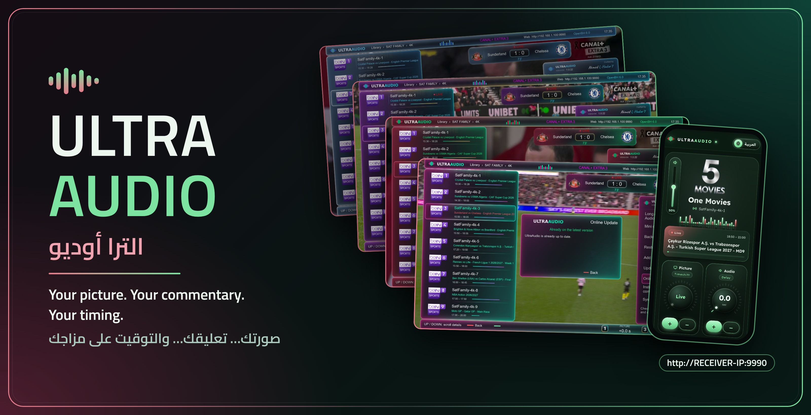</a>

<br />

[](https://github.com/K3bOra/UltraAudio/releases/latest)
[](#compatibility)
[](#compatibility)
[](https://github.com/K3bOra/UltraAudio/releases)

<a href="#install">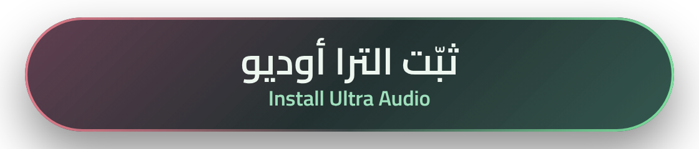</a>
<a href="https://github.com/K3bOra/UltraAudio/releases">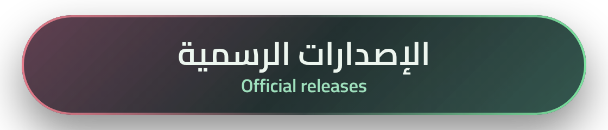</a>

<p dir="rtl"><b>صورتك… تعليقك… والتوقيت على مزاجك.</b></p>

**Your picture. Your commentary. Your timing.** Internet audio, independent picture/audio timing and control from your receiver or phone — built for Enigma2.

<p dir="rtl"><a href="#updates">الجديد</a> · <a href="#experience">الصور</a> · <a href="#mobile">الموبايل</a> · <a href="#sync">التزامن</a> · <a href="#features">المميزات</a> · <a href="#install">التثبيت</a> · <a href="#faq">الأسئلة</a></p>

[What's new](#updates) · [Screenshots](#experience) · [Mobile control](#mobile) · [Timing](#sync) · [Features](#features) · [Install](#install) · [FAQ](#faq)

</div>

<a name="overview"></a>

<p align="center">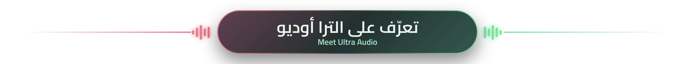</p>

<p dir="rtl">شغّل صوتية من الإنترنت مع قناة التلفزيون اللي بتشاهدها على رسيفر Enigma2. اختار تعليقك، واضبط تأخير الصورة والصوتية كل واحدة لوحدها، وتحكم من الريموت أو الموبايل على نفس الشبكة.</p>

Play internet audio alongside the TV channel you are watching on your Enigma2 receiver. Choose your commentary, adjust picture and audio delays independently, and control playback from the remote or a phone on the same network.

<p dir="rtl">نفس روح التصميم مع عيلة Ultra، بثيمات Ultra Audio الخاصة ومكتبة منظمة وأدوات مخصصة للتحكم في الصوت.</p>

A shared visual language with the Ultra family, with Ultra Audio's own themes, an organized library and dedicated audio controls.

<a name="updates"></a>

<p align="center">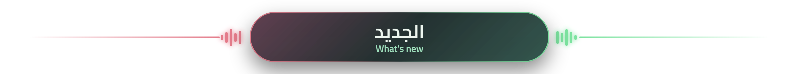</p>

<div align="center">

### Ultra Audio V1.0.25

</div>

<p dir="rtl">إصدار <b>V1.0.25</b> يجمع <b>IPK 1.0.25</b> و<b>DreamOS DEB 1.0.25-dreamos</b>، والاسم الرئيسي للبلجن يظل <b>Ultra Audio Final V1</b>.</p>

Release **V1.0.25** includes **IPK 1.0.25** and **DreamOS DEB 1.0.25-dreamos**. The plugin's product name remains **Ultra Audio Final V1**.

<ul dir="rtl">
<li>دمج مولدات قوائم الصوتيات SatFamily وOrange وAnis مباشرة داخل Ultra Audio لتسهيل إنشاء القوائم وإدارتها.</li>
<li>إضافة زر ⤒ رفع ملف M3U (Upload M3U) في واجهة الويب لاستيراد قوائم الصوتيات مباشرة.</li>
<li>إصلاح وتحسين واجهات WQHD بالكامل لتحسين تحجيم العناصر وتنسيقها وعرضها.</li>
<li>إضافة خط Cairo SemiBold كخيار اختياري في إعدادات خطوط البلجن دون تغيير اختيار المستخدمين الحاليين.</li>
</ul>

- Integrated SatFamily, Orange, and Anis playlist generators directly into Ultra Audio for easier playlist creation and management.
- Added an Upload M3U button to the web interface to import M3U playlists directly.
- Fixed and optimized WQHD interfaces for improved scaling, layout, and display consistency.
- Added Cairo SemiBold as an optional plugin UI font without changing existing users' font preferences.

[Full release notes and downloads](https://github.com/K3bOra/UltraAudio/releases/latest) · [Previous releases](https://github.com/K3bOra/UltraAudio/releases)

<a name="experience"></a>

<p align="center">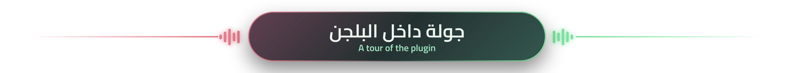</p>

<p align="center"><a href="screenshots/ua-tv-library-neon.jpg">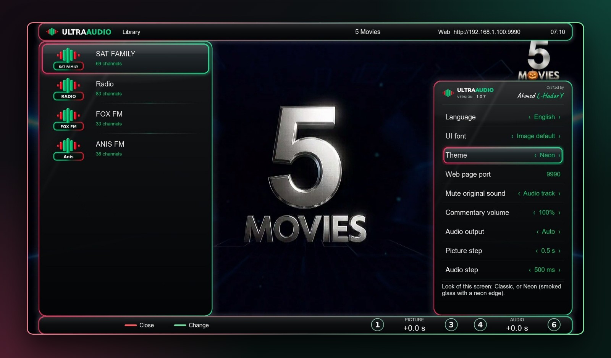</a></p>

<p dir="rtl" align="center"><b>نفس الصورة… بصوت تختاره أنت.</b> اختار من مكتبة الصوتيات والراديو مع استمرار عرض قناة التلفزيون، وتصفح المجلدات واضبط التشغيل من داخل البلجن.</p>
<p align="center"><b>Familiar picture. Your choice of sound.</b> Choose from your audio and radio library while the TV channel stays on screen; browse folders, pick a source and adjust playback.</p>

<a name="themes"></a>

<p align="center">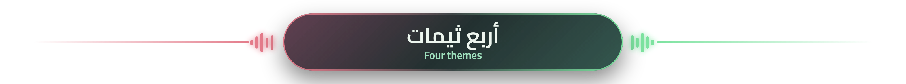</p>

<table>
<tr><td align="center" width="50%"><a href="screenshots/ua-tv-theme-neon.jpg">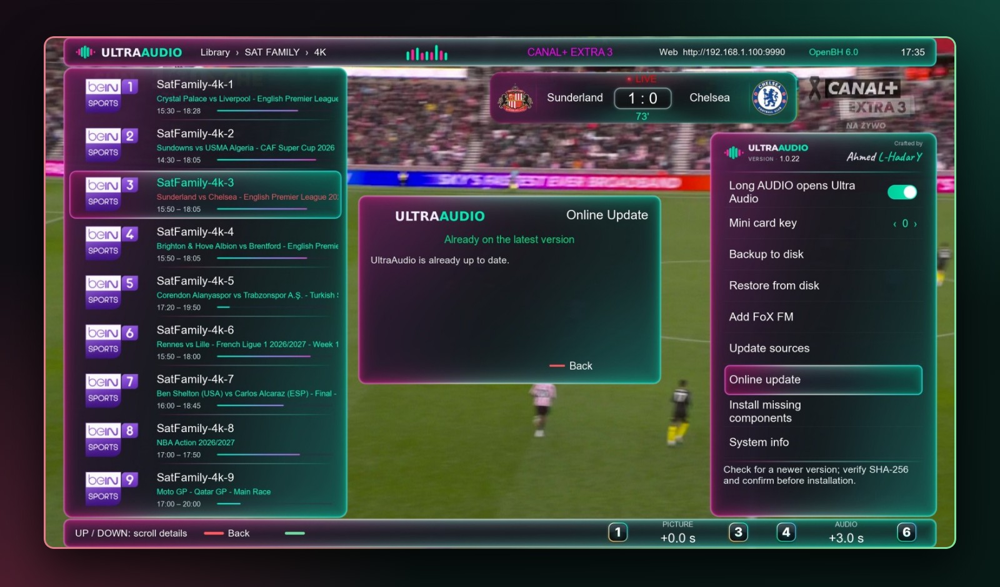</a><br /><b>Neon</b><br /><sub>Rose & mint</sub></td><td align="center" width="50%"><a href="screenshots/ua-tv-theme-ruby.jpg">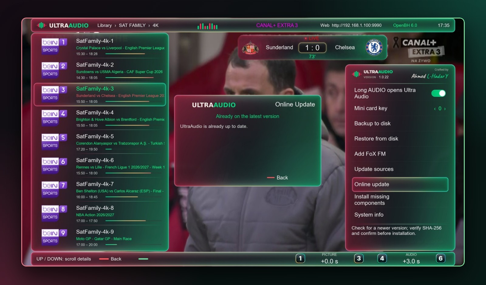</a><br /><b>الياقوتي</b><br /><sub>Ruby & emerald</sub></td></tr>
<tr><td align="center" width="50%"><a href="screenshots/ua-tv-theme-blue.jpg">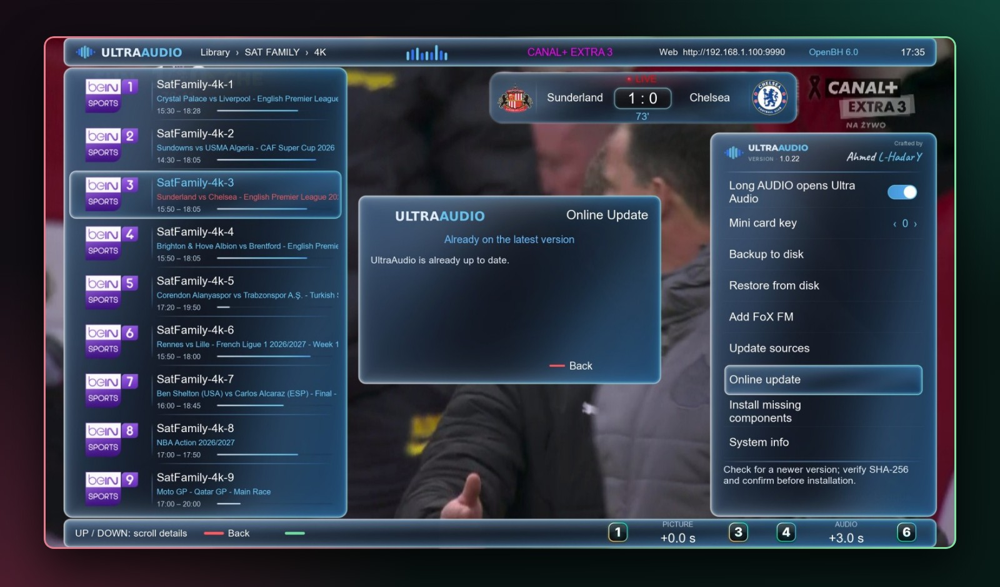</a><br /><b>الأزرق</b><br /><sub>Blue</sub></td><td align="center" width="50%"><a href="screenshots/ua-tv-theme-purple.jpg">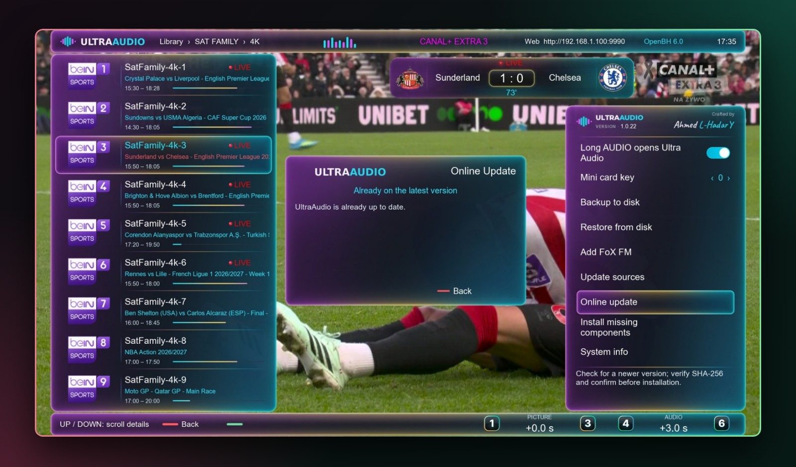</a><br /><b>البنفسجي</b><br /><sub>Purple</sub></td></tr>
</table>

<p dir="rtl" align="center">نفس الشاشة بأربع ثيمات: المكتبة، والنتيجة المباشرة، والتحديث أونلاين، والإعدادات.</p>
<p align="center">The same screen in four themes: the library, the live score, online update and settings.</p>

<details>
<summary><b>الإعدادات والتحديث أونلاين / Settings & online updates</b></summary>

<br />

<p align="center"><a href="screenshots/ua-tv-updates-neon.jpg">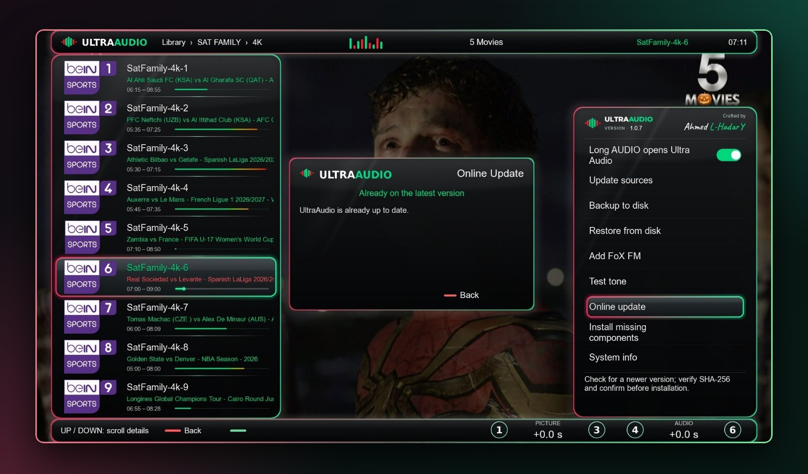</a></p>

</details>

<a name="mobile"></a>

<p align="center">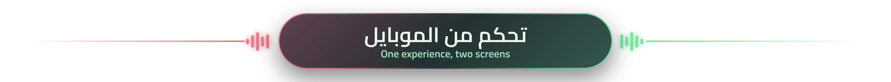</p>

<p dir="rtl">كارت التشغيل بيعرض قناة التلفزيون الحالية وبايكونها والصوتية المختارة. اضبط مستوى الصوت والتزامن، ونظم المجلدات واستورد المصادر واعمل نسخة احتياطية للمكتبة من المتصفح.</p>

The playback card shows the current TV channel, its picon and the selected audio source. Adjust volume and timing, organize folders, import sources and back up your library from your browser.

<p align="center"><a href="screenshots/ua-mobile-showcase.jpg">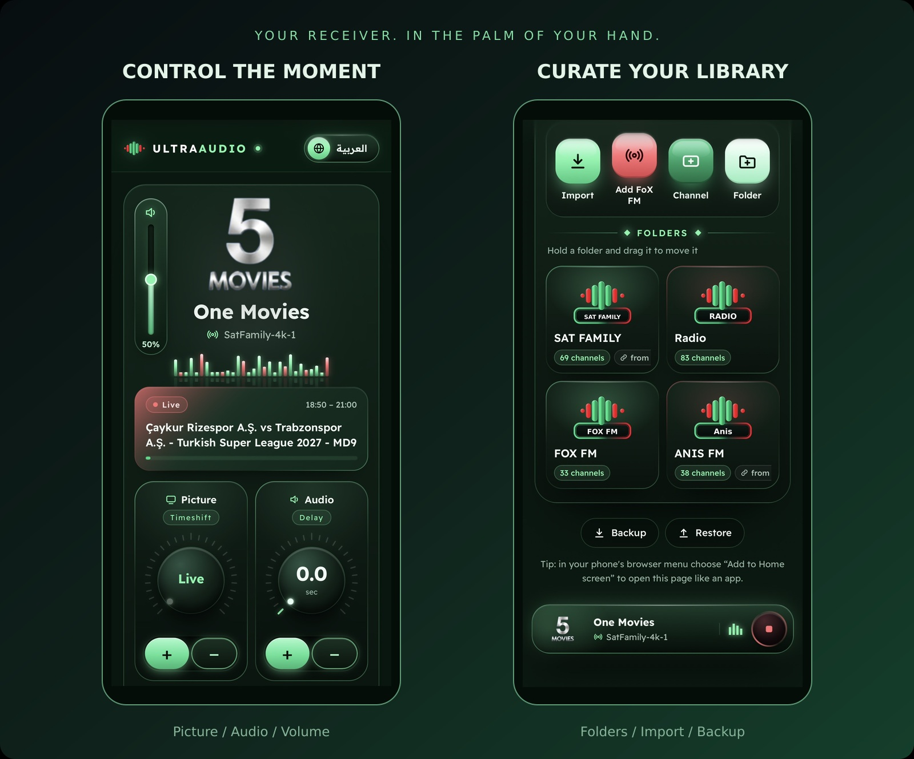</a></p>

<p align="center"><a href="screenshots/ua-mobile-control.jpg">Full control screen · شاشة التحكم كاملة</a> · <a href="screenshots/ua-mobile-library.jpg">Full library screen · شاشة المكتبة كاملة</a></p>

<p dir="rtl">من جهاز متصل <b>بنفس شبكة الرسيفر</b>، افتح العنوان ده واستبدل <code dir="ltr">RECEIVER-IP</code> بعنوان الرسيفر المحلي:</p>

On a device connected to the **same network as your receiver**, open this address and replace `RECEIVER-IP` with the receiver's local IP:

```text
http://RECEIVER-IP:9990
```

<p dir="rtl">المنفذ الافتراضي <b>9990</b> ويمكن تغييره من الإعدادات. تقدر تضيف الصفحة للشاشة الرئيسية للموبايل للوصول السريع.</p>

The default port is **9990** and can be changed in Settings. Add the page to your phone's home screen for quicker access.

<a name="sync"></a>

<p align="center">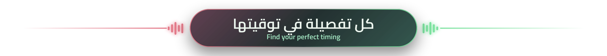</p>

Adjust the picture and internet audio separately until they match the timing you want.

اضبط الصورة والصوتية كل واحدة بشكل مستقل لحد ما توصل للتوقيت المناسب ليك.

| Control<br>التحكم | What it does<br>وظيفته |
|:---|:---|
| **Picture / Timeshift**<br>الصورة / التايم شيفت | Adjust the delay of the TV picture.<br>ضبط تأخير صورة التلفزيون. |
| **Audio / Delay**<br>الصوتية / التأخير | Increase or reduce audio delay, or reset it to zero.<br>زيادة أو تقليل تأخير الصوتية، أو إرجاعه للصفر. |
| **Freeze / Resume**<br>التجميد / الاستئناف | Freeze or resume the picture from the remote or web interface.<br>تجميد الصورة أو استئنافها من الريموت أو صفحة الويب. |
| **Per-channel memory**<br>ذاكرة لكل قناة | Remember the audio source and timing for each TV channel.<br>حفظ الصوتية والتزامن لكل قناة تلفزيون واستعادتهما عند الرجوع إليها. |
| **Stop**<br>إيقاف | Stop the audio and clear the channel's saved association.<br>إيقاف الصوتية وإلغاء الربط المحفوظ للقناة. |

Picture delay requires working timeshift and suitable storage on the receiver.

تأخير الصورة يحتاج تايم شيفت شغال ومساحة تخزين مناسبة على الرسيفر.

### Remote shortcuts
#### اختصارات الريموت

**0 opens/closes the playback card over TV while commentary is active; EXIT closes it. Inside the main plugin, 0 retains picture reset.**<br>
**زر 0 يفتح ويغلق الكارت فوق القناة أثناء تشغيل الصوتية، وEXIT يغلقه. داخل شاشة البلجن الرئيسية يظل 0 لتصفير الصورة.**

| Key<br>الزر | Action<br>الوظيفة |
|:---|:---|
| **1 / 3** | Adjust picture delay.<br>تعديل تأخير الصورة. |
| **4 / 6** | Adjust audio delay.<br>تعديل تأخير الصوتية. |
| **Green**<br>الأخضر | Freeze / resume the picture.<br>تجميد الصورة أو استئنافها. |
| **Red**<br>الأحمر | Stop the audio.<br>إيقاف الصوتية. |
| **Blue**<br>الأزرق | Reset audio delay to zero.<br>إعادة تأخير الصوتية للصفر. |
| **Yellow / 0**<br>الأصفر / 0 | Return the picture to live and close timeshift.<br>إرجاع الصورة لايف وإغلاق التايم شيفت. |
| **CH+ / CH−** | Move between Settings pages.<br>التنقل بين صفحات الإعدادات. |


<a name="features"></a>

<p align="center">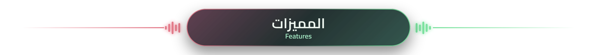</p>

<p align="center">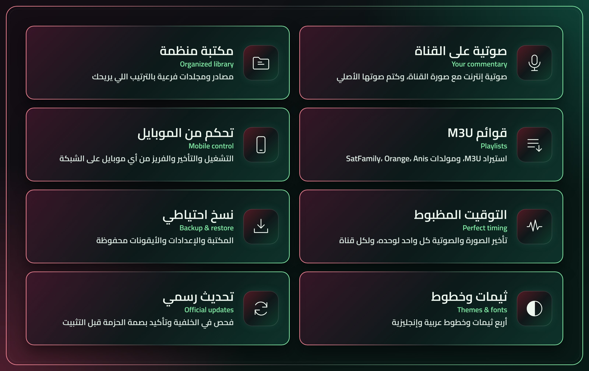</p>

<details>
<summary><b>Full feature descriptions<br>تفاصيل المميزات كاملة</b></summary>

**Your commentary**

**صوتية مع قناة الرسيفر**

Internet audio alongside the current TV picture, with options to mute the channel's original audio.

تشغيل صوتية إنترنت مع الصورة الحالية، مع خيارات لكتم صوت القناة الأصلي.

**Organized library**

**مكتبة منظمة**

Sources and subfolders with add, edit, delete and ordering controls.

مصادر ومجلدات فرعية، مع الإضافة والتعديل والحذف وترتيب القوائم.

**Source management**

**إدارة المصادر**

Import M3U lists and manage sources from the plugin or web interface; update sources from Settings.

استيراد قوائم M3U وإدارة المصادر من البلجن أو الويب، وتحديث المصادر من الإعدادات.

**Audio icons**

**أيقونات الصوتيات**

Search, preview and assign included icons from the web interface; associations survive source updates and backups.

البحث في الأيقونات المرفقة ومعاينتها واختيارها من الويب، مع حفظ الربط بعد تحديث المصادر والنسخ الاحتياطي.

**Channel picons**

**بايكون القناة**

Show the current TV channel picon, with a fallback when unavailable.

عرض بايكون قناة التلفزيون الحالية، مع أيقونة بديلة عند عدم توفره.

**Two-screen control**

**تحكم من شاشتين**

Playback, timing, freeze and stop from the remote or phone.

التشغيل والتأخير والفريز والإيقاف من الريموت أو الموبايل.

**Backup & restore**

**نسخ احتياطي واستعادة**

Preserve the library, settings and icon associations.

حفظ المكتبة والإعدادات وروابط الأيقونات.

**Arabic & English**

**العربية والإنجليزية**

Both languages across the receiver interface, Settings and web page.

واجهة الرسيفر والإعدادات وصفحة الويب باللغتين.

**Themes & fonts**

**الثيمات والخطوط**

Neon theme, six optional Arabic/English fonts and the image's default font.

ثيم Neon، وستة خطوط عربية وإنجليزية اختيارية، بالإضافة لخط الصورة الأساسي.

**Official online updates**

**تحديث رسمي أونلاين**

Background checks, release notes and package verification before installation.

فحص في الخلفية وعرض ملاحظات الإصدار والتحقق من الحزمة قبل التثبيت.

</details>


<a name="compatibility"></a>

<p align="center">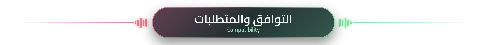</p>

| Requirement<br>المتطلب | Details<br>التفاصيل |
|:---|:---|
| Platform<br>المنصة | Enigma2 receiver<br>رسيفر Enigma2 |
| IPK / OPKG | Python 3.5 or newer<br>بايثون 3.5 أو أحدث |
| DreamOS DEB / DPKG | Python 2.7.9+ or Python 3.5+<br>بايثون 2.7.9 فأحدث أو 3.5 فأحدث |
| Access<br>الوصول | Root via Telnet / SSH<br>حساب root عبر Telnet أو SSH |
| Internet<br>الإنترنت | Required for online sources and updates.<br>مطلوب لمصادر الإنترنت والتحديثات. |
| Picture delay<br>تأخير الصورة | Working timeshift and suitable receiver storage.<br>تايم شيفت شغال وتخزين مناسب على الرسيفر. |
| Mobile control<br>التحكم من الموبايل | A browser on the same local network.<br>متصفح متصل بنفس الشبكة المحلية. |

These are the published requirements, not confirmation that every receiver and image has been tested.

دي المتطلبات المنشورة، وليست تأكيدًا إن كل جهاز وصورة تشغيل تم اختبارهم عمليًا.


<a name="install"></a>

<p align="center">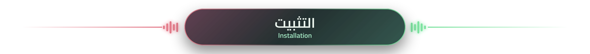</p>

<p align="center">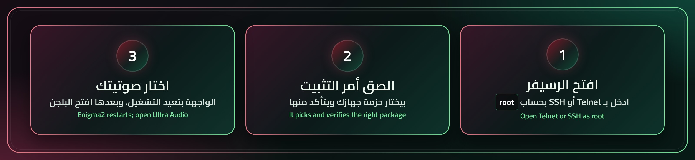</p>

```sh
wget -qO- https://raw.githubusercontent.com/K3bOra/UltraAudio/main/install.sh | /bin/sh
```

The installer detects the image package manager and selects IPK for OPKG or DEB for DreamOS/DPKG. It verifies HTTPS, SHA-256, package size, name, architecture and version before installation. A Dreambox running an OPKG image uses IPK; the hardware name alone does not determine the package. Ambiguous package managers and unsupported Python 2 OPKG images stop with an error. Setup checks required components using the image's feeds.

المثبت يختار IPK لصور OPKG أو DEB لـDreamOS/DPKG، ويتحقق من HTTPS والبصمة والحجم واسم الحزمة ومعماريتها ورقمها قبل التثبيت. جهاز دريم بوكس بصورة OPKG يأخذ IPK؛ الاختيار حسب الصورة وليس اسم الجهاز فقط. لو مدير الحزم غير واضح، أو صورة OPKG تعمل ببايثون 2، يتوقف برسالة واضحة. وبعدها يفحص المكونات المطلوبة من مستودعات الصورة.

**DreamOS migration:** users on the old **1.0.23-dreamos / 1.0.24-dreamos** numbering should run this command once. It installs **1.0.22-dreamos** over the old package without requiring manual removal, preserving the library and settings. Subsequent updates use the dedicated DreamOS online channel and advance alongside IPK.

**لمستخدمي DreamOS بإصدار 23 أو 24 القديم:** شغّل نفس الأمر مرة واحدة. يثبت **1.0.22-dreamos** فوق النسخة القديمة دون حذفها يدويًا، مع الحفاظ على المكتبة والإعدادات. بعدها التحديث من داخل البلجن بمسار DreamOS مستقل، ويتقدم الرقم بالتوازي مع IPK.

[Review the installer](install.sh) · [Download IPK or DreamOS DEB](https://github.com/K3bOra/UltraAudio/releases/latest)

[راجع سكربت التثبيت](install.sh) · [حمّل IPK أو DreamOS DEB](https://github.com/K3bOra/UltraAudio/releases/latest)

> Setup restarts Enigma2 after successful checks. Back up important receiver settings first.
>
> التجهيز بيعيد تشغيل واجهة Enigma2 بعد نجاح الفحص. احتفظ بنسخة احتياطية من إعدادات الرسيفر المهمة أولًا.

### First run
#### أول تشغيل

1. Tune to the TV channel you want to watch.<br>شغّل قناة التلفزيون اللي عايز تشاهدها.
2. Open Ultra Audio and select your audio source.<br>افتح الترا أوديو واختار الصوتية المناسبة.
3. Adjust picture and audio timing from the remote or web page.<br>اضبط توقيت الصورة والصوتية من الريموت أو صفحة الويب.
4. Return to the channel and enjoy your chosen commentary.<br>ارجع للقناة واستمتع بالتعليق اللي اخترته.


<a name="faq"></a>

<p align="center">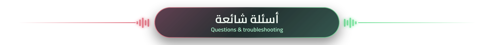</p>

<details>
<summary><b>The mobile page will not open.<br>صفحة الموبايل مش بتفتح.</b></summary>

Check that both devices are on the same network and that you entered the receiver's current local IP and the port configured in Settings. The default port is 9990.

تأكد إن الجهازين على نفس الشبكة، وإنك كتبت عنوان الرسيفر المحلي الحالي والمنفذ الموجود في الإعدادات. المنفذ الافتراضي 9990.

</details>

<details>
<summary><b>The picture delay is not working.<br>تأخير الصورة مش شغال.</b></summary>

Check that the receiver's timeshift works and that its storage is available with enough free space. Use Yellow or 0 to return the picture to live.

تأكد إن التايم شيفت على الرسيفر شغال، وإن وحدة التخزين متاحة وفيها مساحة كافية. استخدم الأصفر أو 0 للرجوع بالصورة للايف.

</details>

<details>
<summary><b>An audio source has no sound.<br>الصوتية مش بتطلع صوت.</b></summary>

Check the internet connection, receiver volume and mute state, then try another source. If only one source fails, check that source's URL and availability.

راجع الإنترنت ومستوى صوت الرسيفر وحالة كتم الصوت، وجرب مصدر تاني. لو المشكلة في مصدر واحد بس، راجع رابطه وتوفره.

</details>

<details>
<summary><b>Will updating remove my library?<br>هل التحديث هيمسح مكتبتي؟</b></summary>

Updates are designed to preserve the library and settings. Use Backup before making important changes.

التحديثات مصممة للحفاظ على المكتبة والإعدادات. استخدم النسخ الاحتياطي قبل أي تغييرات مهمة.

</details>

<details>
<summary><b>How do I report a problem?<br>أبلغ عن مشكلة إزاي؟</b></summary>

[Open an issue](https://github.com/K3bOra/UltraAudio/issues) with the receiver model, image, Python version, plugin version, steps to reproduce and full error text. Remove private source URLs and credentials first.

[افتح بلاغ مشكلة](https://github.com/K3bOra/UltraAudio/issues)، واكتب موديل الرسيفر واسم الصورة وإصدار بايثون والبلجن وخطوات ظهور المشكلة ورسالة الخطأ كاملة. امسح روابط المصادر الخاصة وبيانات الدخول قبل النشر.

</details>


<a name="ultra-family"></a>

<p align="center">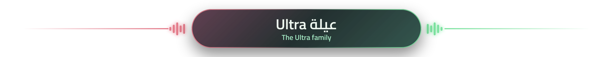</p>

<p align="center">
<a href="https://github.com/K3bOra/UltraQuran">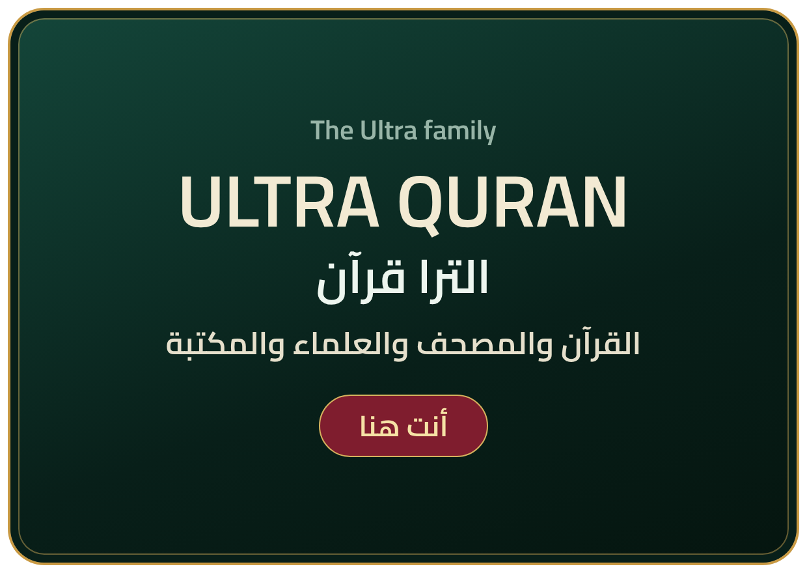</a>
<a href="https://github.com/K3bOra/UltraStalker">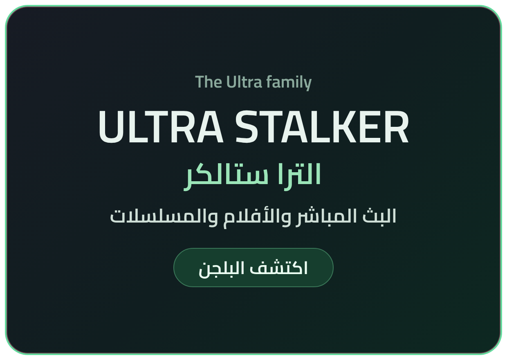</a>
<a href="https://github.com/K3bOra/UltraAudio">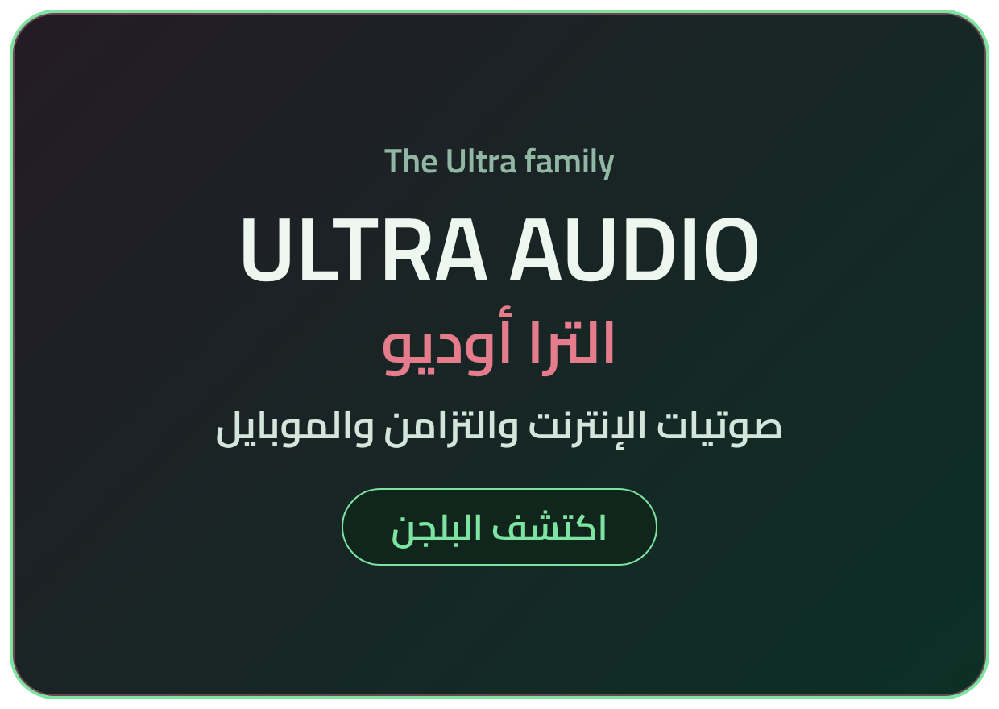</a>
</p>

<p dir="rtl" align="center">تلات بلجنات من عيلة واحدة، ولكل واحد أمر تثبيت وتحديثات رسمية خاصة بيه.</p>
<p align="center">Three plugins, one family. Each has its own install command and official updates.</p>

<a name="resources"></a>

<p align="center">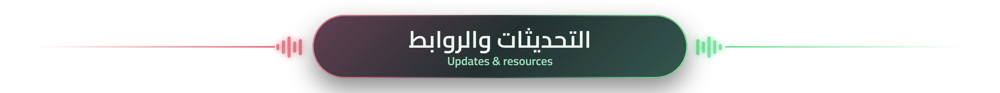</p>

- [Official releases and history](https://github.com/K3bOra/UltraAudio/releases)<br>[الإصدارات الرسمية وسجل التحديثات](https://github.com/K3bOra/UltraAudio/releases)
- [Latest release manifest](https://github.com/K3bOra/UltraAudio/releases/latest/download/update.json)<br>[ملف بيانات أحدث إصدار](https://github.com/K3bOra/UltraAudio/releases/latest/download/update.json)
- [Repository manifest](update.json)<br>[نسخة بيانات التحديث في المستودع](update.json)
- [Publishing guide](RELEASING.md)<br>[دليل نشر الإصدارات](RELEASING.md)


<p dir="rtl">المشروع منشور بترخيص <a href="LICENSE">MIT</a>.</p>

Released under the [MIT License](LICENSE).

<br />

<p align="center">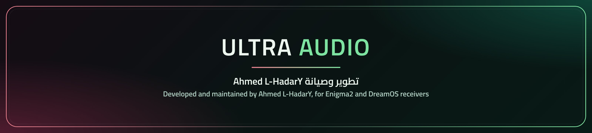</p>
