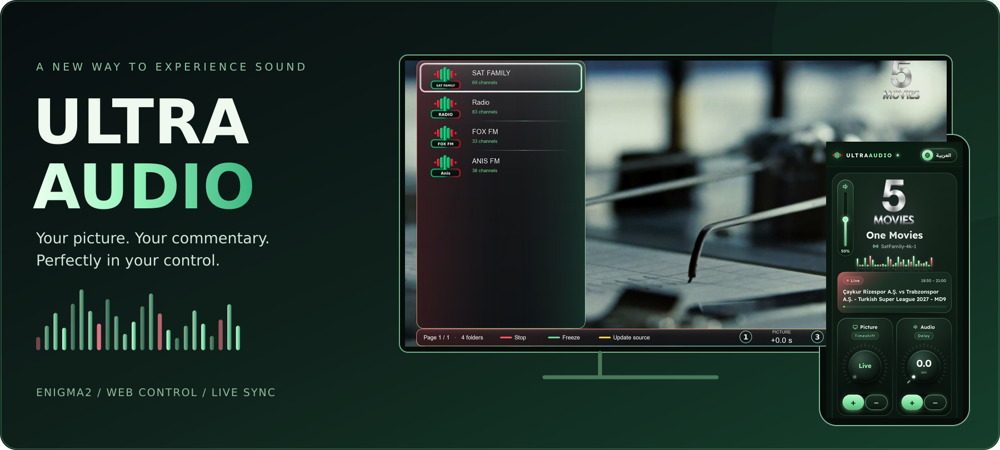
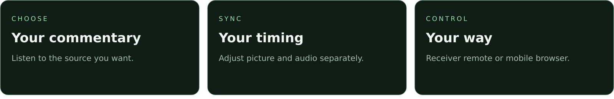
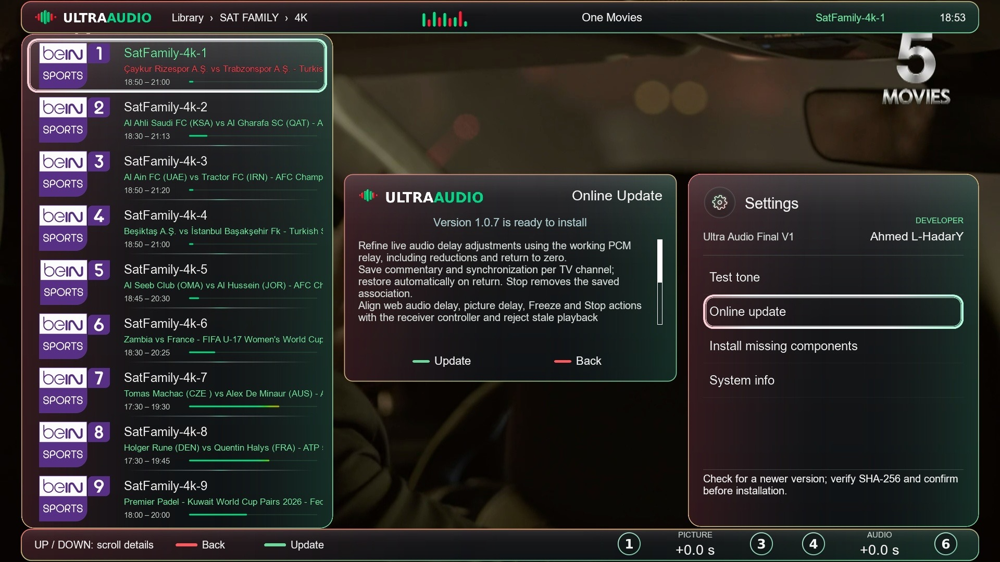

<div align="center">



<br />

**اختار تعليقك… واضبط الصوت والصورة على مزاجك**

Your picture. Your commentary. Your timing.

[](https://github.com/K3bOra/UltraAudio)
[](https://github.com/K3bOra/UltraAudio/releases/latest)
[](install.sh)
[](#mobile)

**[معرض الصور](#experience) · [التحكم من الموبايل](#mobile) · [التزامن](#sync) · [المميزات](#features) · [التثبيت](#install)**

Developed by **Ahmed L-HadarY**

</div>



<div dir="rtl">

**Ultra Audio Final** يتيح لك تشغيل صوتية من الإنترنت مع قناة التلفزيون التي تشاهدها على رسيفر Enigma2، وضبط تأخير الصورة والصوتية بشكل مستقل. مكتبتك، توقيتك، والتحكم في التشغيل — من الريموت أو متصفح الموبايل على نفس الشبكة.

</div>

<a name="experience"></a>


<div dir="rtl">

### صورة مألوفة… بصوت تختاره أنت

اختر مصدرك من مكتبة الصوتيات والراديو، وتابع القناة نفسها مع التحكم في الصوت والتزامن من واجهة البلجن. مجلدات واضحة، أيقونات موحدة، وشريط تحكم مباشر أثناء التشغيل.

</div>

<p align="center"><a href="screenshots/ua-tv-library.jpg"></a></p>

<a name="mobile"></a>


<div dir="rtl">

### الرسيفر في إيدك

كارت التشغيل يعرض **قناة التلفزيون وبايكونها**، واسم الصوتية المستخدمة. تحكم في مستوى الصوت وتأخير الصورة والصوتية، ونظم المجلدات واستورد مصادر الصوتيات واعمل نسخة احتياطية — من متصفحك.

</div>

<p align="center"><a href="screenshots/ua-mobile-showcase.jpg"></a></p>

<p align="center"><a href="screenshots/ua-mobile-control.jpg">عرض شاشة التحكم كاملة</a> · <a href="screenshots/ua-mobile-library.jpg">عرض شاشة المكتبة كاملة</a></p>

<div dir="rtl">

افتح العنوان التالي من جهاز متصل **بنفس شبكة الرسيفر**، واستبدل `RECEIVER-IP` بعنوانه المحلي:

</div>

```text
http://RECEIVER-IP:9990
```

<div dir="rtl">

المنفذ الافتراضي **9990** ويمكن تغييره من الإعدادات. وللوصول السريع، يمكنك إضافة الصفحة إلى الشاشة الرئيسية من قائمة متصفح الموبايل.

</div>

<a name="sync"></a>


<div dir="rtl">

### كل تفصيلة في توقيتها

| التحكم | وظيفته |
| :--- | :--- |
| **Picture / Timeshift** | تعديل تأخير صورة التلفزيون للوصول للتوقيت المناسب. |
| **Audio / Delay** | زيادة أو تقليل تأخير الصوتية بشكل مستقل، مع إمكانية العودة للصفر. |
| **Freeze / Resume** | تجميد الصورة أو استئنافها من الريموت أو صفحة الويب. |
| **ذاكرة لكل قناة** | حفظ الصوتية والتزامن لقناة التلفزيون واستعادتهما عند العودة إليها في إصدار 1.0.7. |
| **Stop** | إيقاف الصوتية وإلغاء الربط المحفوظ للقناة. |

**تأخير الصورة يحتاج تايم شيفت ومساحة تخزين مناسبة على الرسيفر.**

### اختصارات الريموت

| الزر | الوظيفة |
| :--- | :--- |
| **1 / 3** | تعديل تأخير الصورة. |
| **4 / 6** | تعديل تأخير الصوتية. |
| **الأخضر** | تجميد الصورة أو استئنافها. |
| **الأحمر** | إيقاف الصوتية. |
| **الأزرق** | إعادة تأخير الصوتية إلى الصفر. |

</div>

<a name="features"></a>


<div dir="rtl">

| الميزة | التجربة |
| :--- | :--- |
| **صوتية مع قناة الرسيفر** | اختر تعليقك مع الصورة الحالية، مع خيارات لكتم صوت القناة الأصلي. |
| **مكتبة منظمة** | مصادر ومجلدات فرعية، مع الإضافة والتعديل والحذف وترتيب القوائم. |
| **استيراد وتحديث المصادر** | إدارة قوائم الصوتيات من داخل البلجن أو الويب، بما يشمل استيراد M3U. |
| **أيقونات لكل صوتية** | اختيار أيقونة من الصور المرفقة عبر الويب، مع البحث والمعاينة والحفظ بعد تحديث المصدر. |
| **بايكون القناة الفعلية** | يظهر في كارت تشغيل الويب من `/media/hdd/picon`، مع أيقونة بديلة عند عدم توافره. |
| **تحكم من شاشتين** | أوامر التشغيل والتأخير والفريز والإيقاف من الريموت أو الموبايل. |
| **نسخ احتياطي واستعادة** | احتفظ بالمكتبة والإعدادات وروابط الأيقونات. |
| **العربية والإنجليزية** | واجهة الرسيفر والإعدادات وصفحة الويب باللغتين. |
| **اختيار الخط** | ستة خطوط عربية وإنجليزية، بالإضافة إلى خط الصورة الأساسي. |
| **تحديث أونلاين** | فحص في الخلفية وإشعار عند وجود تحديث، مع عرض الملاحظات والتحقق من الحزمة قبل التثبيت. |

</div>

<a name="install"></a>


<div dir="rtl">

### التثبيت الرسمي

افتح Telnet أو SSH على الرسيفر بحساب **root** ثم نفّذ:

</div>

```sh
wget -qO- https://raw.githubusercontent.com/K3bOra/UltraAudio/main/install.sh | /bin/sh
```

<p align="center"><strong><a href="install.sh">مراجعة المُثبّت</a> · <a href="https://github.com/K3bOra/UltraAudio/releases/latest">تحميل الحزمة الرسمية IPK</a></strong></p>

<div dir="rtl">

المُثبّت يحمّل الإصدار الرسمي ويتحقق من **SHA-256 وحجم الحزمة واسمها ورقمها**. بعد التثبيت، يفحص البلجن المكونات المطلوبة ويثبت الناقص من مستودعات الصورة، ثم يعيد تشغيل واجهة Enigma2 عند نجاح الفحص. تبقى المكتبة والإعدادات محفوظة عند التحديث.

### أول تشغيل

1. شغّل قناة التلفزيون التي تريد مشاهدتها.
2. افتح Ultra Audio واختر الصوتية المناسبة.
3. اضبط تأخير الصورة والصوتية من الريموت أو صفحة الويب.
4. ارجع للقناة واستمتع بالمشاهدة بالتوقيت الذي ضبطته.

**المتطلبات:** جهاز Enigma2 بصورة تعمل ببايثون **3.5 أو أحدث**، واتصال بالإنترنت لتشغيل المصادر والتحديثات. استخدام تأخير الصورة يحتاج تايم شيفت وتخزين مناسب.

</div>

<a name="updates"></a>


<div dir="rtl">

### الجديد في 1.0.7

- تحسين تعديل تأخير الصوتية أثناء التشغيل، بما يشمل تقليل التأخير والعودة للصفر.
- حفظ الصوتية والتزامن لكل قناة تلفزيون؛ **Stop** يلغي الربط المحفوظ.
- توحيد أوامر الويب والبلجن، ومنع الأوامر المتأخرة من التأثير على تشغيل آخر.
- شريط رأسي أطول للتحكم في صوت الرسيفر من صفحة الويب.
- شريط تقدم رفيع بتدرج أخضر إلى أحمر، بدون دوائر.
- ترتيب أزرار المكتبة وعناوينها وتقليل المسافات.

</div>

<details>
<summary><strong>شاهد شاشة الإعدادات والتحديث الأونلاين</strong></summary>

<p align="center"><a href="screenshots/ua-tv-updates.jpg"></a></p>

</details>

<details>
<summary><strong>ملاحظات الإصدارات السابقة</strong></summary>

<div dir="rtl">

**تحديث 1.0.6:** اختيار أيقونة لكل صوتية من صفحة الويب مع البحث والمعاينة وحفظ الربط بعد تحديث المصدر والنسخ الاحتياطي. تحسين مسار الصوت والتأخير على Dreambox، وتنفيذ أوامر التحكم على خيط Enigma2 الرئيسي، وإصلاح الانتقال من التشغيل المباشر إلى مسار يدعم تأخير الصوت.

**تحديث 1.0.5:** ستة خطوط عربية وإنجليزية اختيارية مع خط الصورة الأساسي من الإعدادات > نوع الخط. إصلاح استيراد M3U والرجوع للمباشر مع التايم شيفت الطويل، وتحسين حماية شريط التقدم وفحص مكونات DVB وترتيب التثبيت. تغيير الخط يحافظ على الفولدر والمؤشر والصوتية الحالية. دليل القنوات الإضافية يعتمد على EPG المخزن في الصورة؛ صوت DM920 يحتاج تأكيدًا عمليًا على الجهاز.

**تحديث 1.0.3:** فحص تلقائي صامت في الخلفية عند فتح البلجن، وإشعار عند وجود إصدار جديد مع اختيار تحديث أو رجوع. نسبة تحميل فعلية من 1 إلى 100%، ثم مراحل التثبيت وفحص المكونات، مع تحديث الكارت من تايمر Enigma2 وإعادة تشغيل الواجهة بعد النجاح. يعمل أسلوب العرض الجديد بعد تثبيت هذا الإصدار وإعادة تشغيل الواجهة.

**إصلاحات 1.0.2:** إظهار تفاصيل التحديث بالعربية أو الإنجليزية، وإتمام فحص المكونات قبل إعادة تشغيل واجهة Enigma2.

**إصلاحات 1.0.1:** زر Stop يلغي ذاكرة الصوتية وتأخير الصوت والصورة للقناة، فلا تعود تلقائيًا عند الرجوع إليها. تمت إزالة خيار Preview Update Card التجريبي وحقل GitHub repository؛ يظهر Online Update فقط ومصدره الرسمي مضبوط داخليًا. الاسم الظاهر يظل **Ultra Audio Final V1**.

</div>

</details>

<div dir="rtl">

<details>
<summary><strong>نشر التحديثات القادمة</strong></summary>

المصدر الرسمي هو `K3bOra/UltraAudio`. تم تجهيز إجراء نشر **يدوي فقط**؛ حفظ الملفات أو رفعها للمستودع لا ينشر إصدارًا تلقائيًا.

عند تجهيز تحديث جديد، تُضاف الحزمة الجديدة إلى `packages/` وتُكتب ملاحظات الإصدار في `release-notes.json`. يجب زيادة رقم الحزمة لكل تحديث، مع إبقاء اسم الإصدار الرئيسي V1 ضمن سلسلة 1.x. يُشغَّل إجراء **Publish verified UltraAudio release** يدويًا عند طلب النشر فقط.

سكربت التجهيز يفحص اسم الحزمة ورقمها ومحتوياتها، ويحسب الحجم وبصمة SHA-256 من الملف الفعلي. ثم يجهز إجراء النشر مسودة، ويتحقق من الملفات المرفوعة قبل إتاحة الإصدار. لا يُستبدل إصدار سبق نشره.

التحديث الأونلاين يقرأ ملف `update.json` من آخر إصدار منشور، ويعرض الملاحظات ويطلب موافقة المستخدم قبل التثبيت. لن يُنشَر ملف تحديث تجريبي يشير إلى حزمة غير موجودة.

</details>

</div>

<p align="center"><a href="https://github.com/K3bOra/UltraAudio/releases">كل الإصدارات الرسمية</a> · <a href="https://github.com/K3bOra/UltraAudio/issues">الإبلاغ عن مشكلة</a></p>

---

<div align="center">

**ULTRA AUDIO** · Your picture. Your commentary. Your timing.

Developed and maintained by **Ahmed L-HadarY**

</div>

