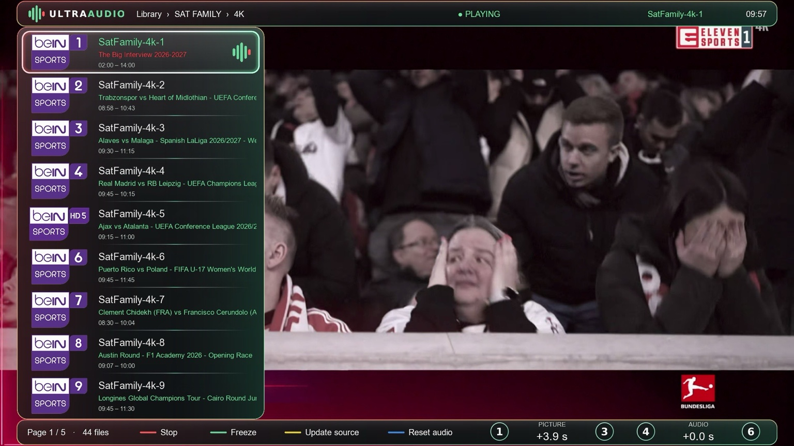
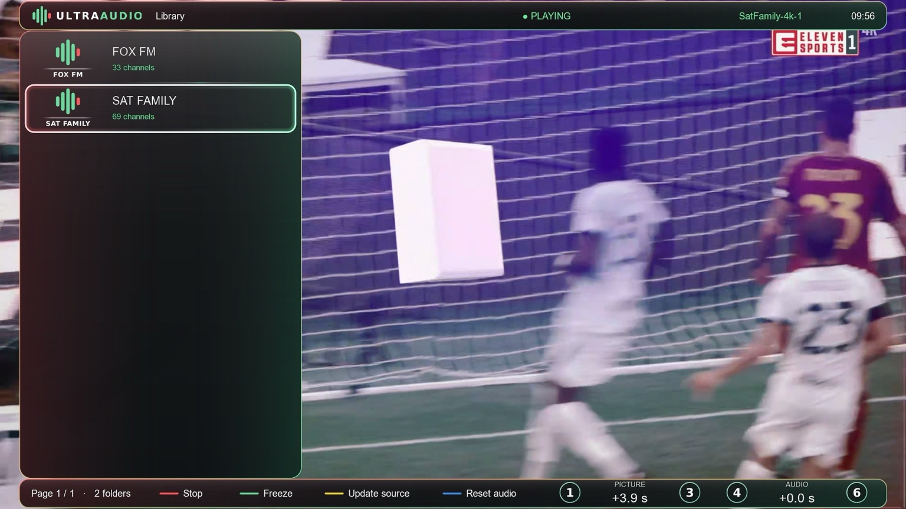
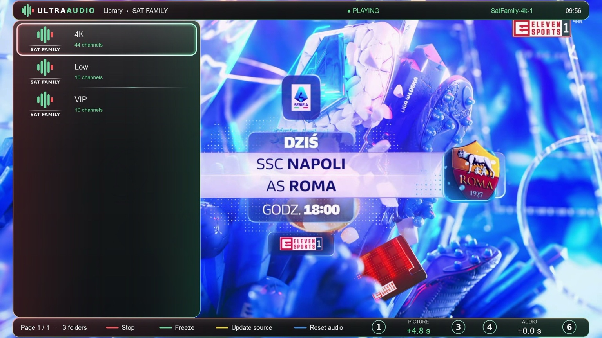
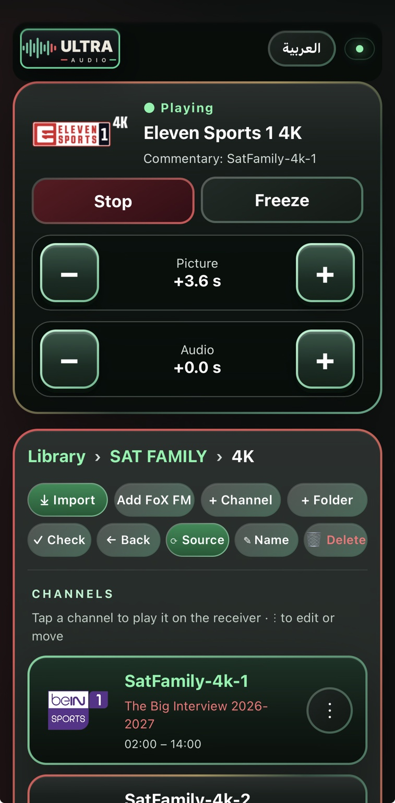

<div align="center">

# Ultra Audio Final

**اختار تعليقك… واضبط الصوت والصورة على مزاجك**

IP Audio Commentary · Enigma2 · Python 3

تطوير **Ahmed L-HadarY**

</div>

---

<div dir="rtl">

**UltraAudio** بلجن لأجهزة Enigma2 يتيح تشغيل صوتية من الإنترنت مع القناة التي تشاهدها على الرسيفر، والتحكم في تأخير الصوت والصورة حتى تصل للتزامن المناسب. يمكنك إدارة مكتبتك من الريموت أو من صفحة الويب على الموبايل.

> **الإصدار الرسمي: V1** · يدعم صور Enigma2 التي تعمل ببايثون 3. حزمة الإصدار ومُثبّت التلنت متاحان من [صفحة الإصدارات](https://github.com/K3bOra/UltraAudio/releases/latest).

**تحديث 1.0.7:** تحسين تعديل تأخير الصوتية أثناء التشغيل بالمسار الصوتي المجرب، مع تقليل التأخير والعودة للصفر. حفظ الصوتية والتزامن لكل قناة تلفزيون واستعادتهما عند العودة؛ زر Stop يلغي الربط المحفوظ. توحيد أوامر تأخير الصوت والصورة والفريز والإيقاف بين الويب والبلجن، ومنع الأوامر المتأخرة من التأثير على تشغيل آخر. إضافة شريط رأسي أطول للتحكم في صوت الرسيفر من صفحة الويب. بروجرس رفيع بتدرج أخضر إلى أحمر بدون دوائر، مع صور مخزنة مسبقًا داخل البلجن. إزالة فحص روابط الويب وتقليل المسافات وترتيب أزرار وعناوين المكتبة.

**تحديث 1.0.6:** اختيار أيقونة لكل صوتية من صفحة الويب مع البحث والمعاينة وحفظ الربط بعد تحديث المصدر والنسخ الاحتياطي. تحسين مسار الصوت والتأخير على Dreambox، وتنفيذ أوامر التحكم على خيط Enigma2 الرئيسي، وإصلاح الانتقال من التشغيل المباشر إلى مسار يدعم تأخير الصوت.

**تحديث 1.0.5:** ستة خطوط عربية وإنجليزية اختيارية مع خط الصورة الأساسي من الإعدادات > نوع الخط. إصلاح استيراد M3U والرجوع للمباشر مع التايم شيفت الطويل، وتحسين حماية شريط التقدم وفحص مكونات DVB وترتيب التثبيت. تغيير الخط يحافظ على الفولدر والمؤشر والصوتية الحالية. دليل القنوات الإضافية يعتمد على EPG المخزن في الصورة؛ صوت DM920 يحتاج تأكيدًا عمليًا على الجهاز.

**تحديث 1.0.3:** فحص تلقائي صامت في الخلفية عند فتح البلجن، وإشعار عند وجود إصدار جديد مع اختيار تحديث أو رجوع. نسبة تحميل فعلية من 1 إلى 100%، ثم مراحل التثبيت وفحص المكونات، مع تحديث الكارت من تايمر Enigma2 وإعادة تشغيل الواجهة بعد النجاح. يعمل أسلوب العرض الجديد بعد تثبيت هذا الإصدار وإعادة تشغيل الواجهة.

**إصلاحات 1.0.2:** إظهار تفاصيل التحديث بالعربية أو الإنجليزية، وإتمام فحص المكونات قبل إعادة تشغيل واجهة Enigma2.

**إصلاحات 1.0.1:** زر Stop يلغي ذاكرة الصوتية وتأخير الصوت والصورة للقناة، فلا تعود تلقائيًا عند الرجوع إليها. تمت إزالة خيار Preview Update Card التجريبي وحقل GitHub repository؛ يظهر Online Update فقط ومصدره الرسمي مضبوط داخليًا. الاسم الظاهر يظل **Ultra Audio Final V1**.


## واجهة الرسيفر

قائمة صوتيات فوق القناة نفسها، مع اسم الصوتية الحالية ومعلومات البرامج عند توافرها، وتحكم مباشر من الشريط السفلي.

</div>

<p align="center">
  
</p>

<div dir="rtl">

## مميزات UltraAudio

| الميزة | ماذا تقدم؟ |
| :--- | :--- |
| **صوتية مع قناة الرسيفر** | تشغيل التعليق الذي تختاره مع الصورة الحالية، مع خيارات لكتم الصوت الأصلي. |
| **ضبط الصورة والصوت بشكل مستقل** | تعديل تأخير الصورة باستخدام التايم شيفت، وضبط تأخير الصوتية للوصول للتزامن المناسب. |
| **مكتبة منظمة** | مجلدات ومجلدات فرعية لتنظيم المصادر والصوتيات، مع الإضافة والتعديل والحذف وترتيب القوائم. |
| **استيراد وتحديث المصادر** | استيراد قوائم الصوتيات وتحديث المصدر من داخل البلجن أو صفحة الويب. |
| **تحكم من الموبايل** | تشغيل وإيقاف الصوتية، تجميد الصورة واستئنافها، وضبط التأخير من المتصفح على نفس الشبكة. |
| **اسم قناة الرسيفر وبايكونها** | عرض اسم قناة التلفزيون الفعلية وبايكونها المحلي في كارت التشغيل على الويب. |
| **أيقونة تختارها لكل صوتية** | اختيار وربط أي من الأيقونات المرفقة بصوتية من الويب، مهما اختلف اسمها، مع خيار الرجوع للتعرف التلقائي. |
| **نسخ احتياطي واستعادة** | حفظ المكتبة والإعدادات واستعادتها عند الحاجة. |
| **العربية والإنجليزية** | واجهة وإعدادات وصفحة ويب باللغتين. |
| **تحديث أونلاين** | فحص في الخلفية عند فتح البلجن مع إشعار عند وجود إصدار أحدث، وفحص يدوي من الإعدادات؛ التثبيت يحتاج موافقتك ويتحقق من الحزمة أولًا. |

## مكتبتك مرتبة من أول مصدر لآخر صوتية

تصفح المصادر الرئيسية، ثم ادخل على المجلدات الفرعية للوصول إلى المجموعة التي تريدها.

</div>

<table>
  <tr>
    <td width="50%" align="center"><strong>المصادر الرئيسية</strong></td>
    <td width="50%" align="center"><strong>المجلدات الفرعية</strong></td>
  </tr>
  <tr>
    <td></td>
    <td></td>
  </tr>
</table>

<div dir="rtl">

## التحكم من الموبايل

افتح صفحة البلجن من أي متصفح على نفس شبكة الرسيفر. كارت التشغيل يعرض **اسم قناة التلفزيون وبايكونها**، وتحتها اسم الصوتية المستخدمة، مع أزرار مستقلة للصورة والصوت.

البايكون يُقرأ من المسار المحلي على الرسيفر `/media/hdd/picon`؛ وإذا لم يوجد ملف مناسب تظهر الأيقونة الافتراضية. أما أيقونات قائمة الصوتيات فتظل من الصور المرفقة بالبلجن.

</div>

<p align="center">
  
</p>

<div dir="rtl">

## التثبيت من التلنت

ادخل إلى الرسيفر بحساب **root**، ثم نفّذ الأمر التالي. المُثبّت يحمّل آخر إصدار رسمي ويتحقق من بصمة SHA-256 وحجم الحزمة واسمها ورقمها قبل التثبيت.

</div>

```sh
wget -qO- https://raw.githubusercontent.com/K3bOra/UltraAudio/main/install.sh | /bin/sh
```

<div dir="rtl">

بعد تثبيت الحزمة، يفحص البلجن المكونات المطلوبة ويثبت الناقص من مستودعات الصورة، ثم يعيد تشغيل واجهة Enigma2 عند نجاح الفحص. تبقى مكتبتك وإعداداتك محفوظة عند التحديث.

لتحميل الحزمة يدويًا: [Ultra Audio Final V1](https://github.com/K3bOra/UltraAudio/releases/latest).

## بداية الاستخدام

1. ثبّت النسخة من أمر التلنت أدناه أو من حزمة IPK المرفقة بالإصدار الرسمي.
2. شغّل قناة التلفزيون التي تريد مشاهدتها، ثم افتح UltraAudio واختر الصوتية المناسبة.
3. اضبط تأخير الصورة والصوت من الريموت أو صفحة الويب.
4. لإدارة المكتبة من الموبايل، افتح العنوان التالي واستبدل `RECEIVER-IP` بعنوان الرسيفر على شبكتك:

</div>

```text
http://RECEIVER-IP:9990
```

<div dir="rtl">

المنفذ الافتراضي **9990** ويمكن تغييره من الإعدادات. تأخير الصورة يحتاج تايم شيفت ومساحة تخزين مناسبة على الرسيفر.

### اختصارات أثناء التشغيل

| الزر | الوظيفة |
| :--- | :--- |
| **1 / 3** | تعديل تأخير الصورة. |
| **4 / 6** | تعديل تأخير الصوتية. |
| **الأخضر** | تجميد الصورة أو استئنافها. |
| **الأحمر** | إيقاف الصوتية. |
| **الأزرق** | إعادة تأخير الصوت إلى الصفر. |

### المتطلبات

- جهاز Enigma2 بصورة تعمل ببايثون **3.5 أو أحدث**.
- اتصال بالإنترنت لتشغيل المصادر وفحص التحديثات. يتم الفحص في الخلفية عند فتح البلجن، أو يدويًا من الإعدادات.
- تايم شيفت وتخزين مناسب لاستخدام تأخير الصورة.
- وجود بايكونات القنوات في `/media/hdd/picon` لإظهارها في كارت التشغيل على الويب.

<details>
<summary><strong>نشر التحديثات القادمة</strong></summary>

المصدر الرسمي هو `K3bOra/UltraAudio`. تم تجهيز إجراء نشر **يدوي فقط**؛ حفظ الملفات أو رفعها للمستودع لا ينشر إصدارًا تلقائيًا.

عند تجهيز تحديث جديد، تُضاف الحزمة الجديدة إلى `packages/` وتُكتب ملاحظات الإصدار في `release-notes.json`. يجب زيادة رقم الحزمة لكل تحديث، مع إبقاء اسم الإصدار الرئيسي V1 ضمن سلسلة 1.x. يُشغَّل إجراء **Publish verified UltraAudio release** يدويًا عند طلب النشر فقط.

سكربت التجهيز يفحص اسم الحزمة ورقمها ومحتوياتها، ويحسب الحجم وبصمة SHA-256 من الملف الفعلي. ثم يجهز إجراء النشر مسودة، ويتحقق من الملفات المرفوعة قبل إتاحة الإصدار. لا يُستبدل إصدار سبق نشره.

التحديث الأونلاين يقرأ ملف `update.json` من آخر إصدار منشور، ويعرض الملاحظات ويطلب موافقة المستخدم قبل التثبيت. لن يُنشَر ملف تحديث تجريبي يشير إلى حزمة غير موجودة.

</details>

</div>

---

<div align="center">

**UltraAudio** · Developed by **Ahmed L-HadarY**

</div>


